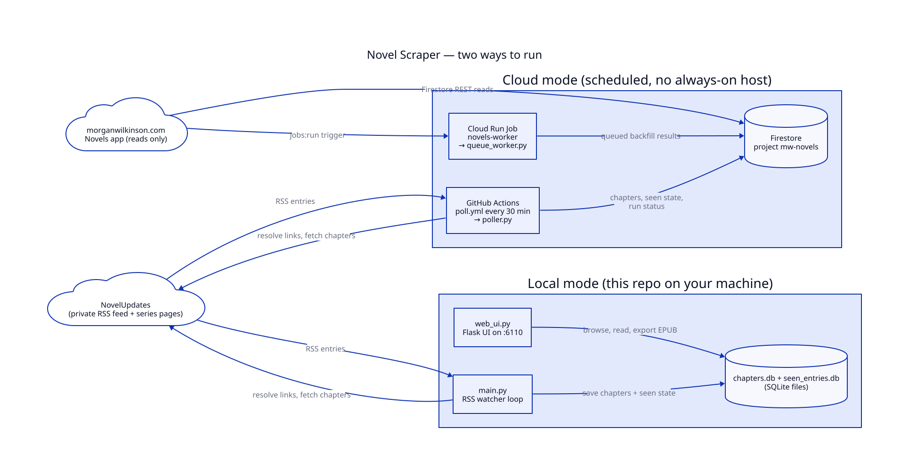
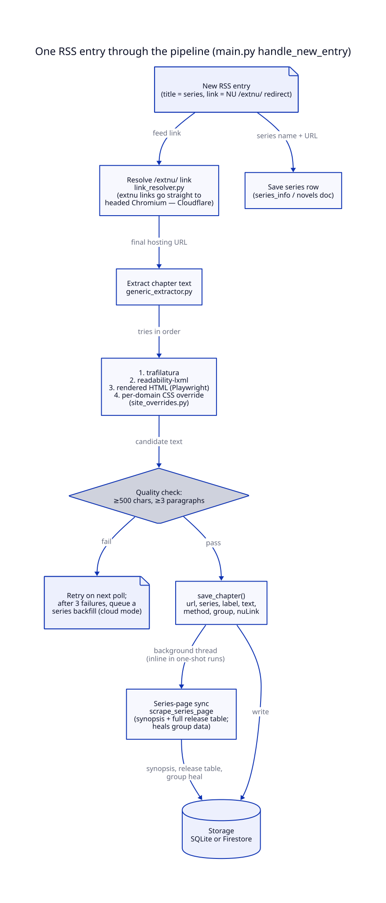
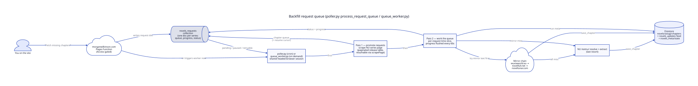

# 01 — Overview and Architecture

> **Who this is for:** beginner developers and non-technical readers.
> **Repository stamp:** base commit `217431f` · branch `feature/update-documentation-2026-10-10` · dated 2026-10-10 · no uncommitted changes when the docs were written.
> Back to [Documentation index](README.md) · Previous version: [archive/2026-10-10_architecture.md](archive/2026-10-10_architecture.md)

## Contents

- [Executive summary](#executive-summary)
- [The two ways it runs](#the-two-ways-it-runs)
- [Diagram: the whole system](#diagram-the-whole-system)
- [Diagram: one RSS entry through the pipeline](#diagram-one-rss-entry-through-the-pipeline)
- [Diagram: the backfill request queue](#diagram-the-backfill-request-queue)
- [Design decisions and why](#design-decisions-and-why)

## Executive summary

**What it does.** [NovelUpdates](https://www.novelupdates.com/) is a directory
site: it lists new chapter releases for translated web novels, but the text
itself lives on hundreds of different hosting sites run by translator groups.
This project automates "go read the chapter": it watches a private NovelUpdates
RSS feed, follows each release's redirect link to the real hosting site,
extracts just the chapter text (stripping ads and navigation), and stores it.

**Who it helps.** The owner reads these novels in a personal library app on
[morganwilkinson.com](https://morganwilkinson.com) that shows the same Firestore
data the cloud pipeline writes. Locally, a small Flask web UI offers the same
library plus EPUB export.

**How it works, at a high level.** A poll loop (or a scheduled cloud run) reads
the feed, skips entries it has seen before, resolves each new `/extnu/` link to
its final URL, tries three extraction strategies in order — trafilatura,
readability-lxml, then a real browser render — and saves the result. A separate
request queue handles "fetch me all the missing chapters of this series" work,
trying three mirror sites before falling back to the original link.

**Why it was built this way.** NovelUpdates and many hosting sites sit behind
Cloudflare's anti-bot check, so plain HTTP alone fails often — that is why a
real browser (Playwright/Chromium) is part of the pipeline. The cloud mode
exists so nothing has to run 24/7: GitHub Actions fires every 30 minutes, and
an on-demand Cloud Run Job handles "fetch this now" requests from the site.

## The two ways it runs

| | Local mode | Cloud mode |
|---|---|---|
| **Started by** | `python start.py` or `docker-compose up -d` | GitHub Actions cron (every 30 min) or a Cloud Run Job triggered from the site |
| **Entry point** | `main.py` (loop) + `web_ui.py` (UI) | `poller.py` (one pass) or `queue_worker.py` (queue only) |
| **Storage** | `chapters.db` + `seen_entries.db` (SQLite files) | Firestore, project `mw-novels` |
| **Runs until** | you stop it | the run's time budget ends |
| **Selected by** | `DB_TYPE=sqlite` (default) | `DB_TYPE=firestore` |

Both modes share the same pipeline code — `data/storage.py` and
`rss/rss_watcher.py` pick the backend from the `DB_TYPE` environment variable.

## Diagram: the whole system

**Walkthrough** — reading the diagram left to right:

1. NovelUpdates publishes a private RSS feed of new chapter releases, plus
   series pages that list every release.
2. In **local mode**, `main.py` polls that feed every 15 minutes (configurable),
   resolves each new link, fetches the chapter, and writes to SQLite.
   `web_ui.py` serves a browser UI on port 6110 reading the same database.
   `start.py` simply launches both as subprocesses.
3. In **cloud mode**, the `poll.yml` GitHub Actions workflow runs `poller.py`
   every 30 minutes. Each run does one RSS pass and one request-queue pass,
   then exits. `queue_worker.py` is the same queue pass packaged as a
   Cloud Run Job so the site can trigger it on demand.
4. Both write to the **Firestore** database in the `mw-novels` Firebase
   project — chapters, dedup state, per-run status, and the request queue.
5. The Novels app on morganwilkinson.com **only reads** Firestore (via its REST
   API, behind Cloudflare Access) and triggers the worker — no code from this
   repo runs on the site's infrastructure.

## Diagram: one RSS entry through the pipeline

**Walkthrough** — one new feed entry, step by step (code: `main.py`
`handle_new_entry`, [line 68](https://github.com/Morgan-Wilkinson/Automated-Novel-Scraper/blob/217431f/main.py#L68)):

1. The entry arrives with a title (the series name) and a link. The series is
   saved to `series_info`/`novels` right away so it appears in the library even
   if the chapter fetch later fails.
2. `resolve_final_url_with_browser_fallback` follows the `/extnu/` redirect.
   NU links go straight to a headed Chromium session because plain requests get
   a Cloudflare `403`.
3. `extract_chapter` tries **trafilatura**, then **readability-lxml**, then
   re-fetches the page rendered in a browser and extracts again.
4. If all three fail the quality check (≥ 500 characters, ≥ 3 paragraphs),
   a per-domain CSS override in `site_overrides.py` gets a last chance
   (currently no overrides are configured).
5. A passing text is saved with its method, the release's translator `group`,
   and the original `nu_link` for later dedup/healing.
6. Each save kicks off a background **series-page sync** — a Playwright scrape
   of the NU series page that stores the synopsis and the full release table,
   and patches `group` onto older chapters that were saved before group capture
   existed ("self-healing" data rather than a migration).
7. If an entry keeps failing, cloud mode retries it up to 3 times across runs,
   then auto-queues a series backfill so the chapter can be recovered through a
   different release link later.

## Diagram: the backfill request queue

**Walkthrough** — code: `poller.py` `process_request_queue`,
[line 176](https://github.com/Morgan-Wilkinson/Automated-Novel-Scraper/blob/217431f/poller.py#L176):

1. On the site's Novels page, "Fetch missing chapters" asks an
   access-gated Pages Function to write a `novels_requests/{slug}` document.
   The poller can also create requests itself when an RSS entry dies for good.
2. The next `poller.py` run (or an on-demand `queue_worker.py` execution)
   picks up `pending`, `processing`, and retryable-`error` requests,
   oldest first.
3. **Pass 1 — promote:** for each request the shared headed-browser session
   scrapes the NU series page's paginated release table. Big tables pause mid
   way — a `scrapePage` cursor + `pendingChapters` are saved on the request so
   the next run resumes instead of restarting. Discovered chapters fold
   straight into the request's live `queue`.
4. **Pass 2 — work the queue:** each queued item is first deduplicated by its
   NU release link (`nuLink`), then tries the mirror chain —
   **wuxiaworld.eu → novelfull.net → novellunar.com** — and only then the
   original NU-linked host. Mirrors are preferred for bulk work because they
   have predictable layouts and (mostly) no Cloudflare wall.
5. Progress flushes to Firestore every 60 seconds; each request gets a
   fair-share slice of the remaining time budget so one slow series can't
   starve the rest. Failed items retry on later runs (3 attempts);
   Cloudflare-blocked items requeue *without* burning an attempt.
6. The site watches the request doc's `status`/`activity` fields live.

## Design decisions and why

- **Why a real browser is in the pipeline.** Headless Chromium never clears
  NovelUpdates' Cloudflare challenge; headed Chromium under `xvfb` does in a
  few seconds. Plain `requests` is still used wherever it works — the browser
  is reserved for NU links and Cloudflare-walled pages.
- **Why one shared browser session in queue processing.** The first navigation
  solves the challenge and the `cf_clearance` cookie covers the rest of the
  run: ~1–2 s per resolve instead of ~9 s, and far fewer challenge rolls to
  trip Cloudflare's rate limiter. The session rebuilds up to 3 times if it
  crashes before items fall back to a standalone resolver.
- **Why Firestore via REST instead of an SDK.** `data/firestore_store.py`
  talks to the Firestore REST API with a service-account OAuth token (via
  `google-auth`), so no `firebase-admin`/`google-cloud-firestore` dependency is
  needed. SA requests bypass the security rules, which lets the rules stay
  "public read, no writes" while the site reads data client-side.
- **Why insert-if-absent everywhere.** Saves use the URL (or its sha256 in
  Firestore) as the key, so re-running a poll or a migration is idempotent —
  nothing duplicates.
- **Why the "self-healing" group data.** Chapters archived before translator
  `group` capture get patched the next time the series' release table is
  scraped or the queue walks past them — no one-off migration to run or
  reverse. A `groupsHealed` flag on the series doc lets later syncs skip the
  scan once nothing healable remains.
- **Why time budgets instead of "run until done".** Cloud runs are capped:
  `RSS_TIME_BUDGET_S` (default 300 s) for the feed, `QUEUE_TIME_BUDGET_S`
  (default 1200 s) for the queue, `POLL_RUN_BUDGET_S` (1260 s) overall —
  leaving headroom under the workflow's 25-minute timeout so progress is
  always flushed before the run can be killed. The Cloud Run worker uses
  `WORKER_RUN_BUDGET_S` (3300 s) under its 3600 s job timeout.
- **Why SQLite locally.** Zero-install, one-file backups, and the web UI reads
  it directly. Cloud mode exists for the always-on use case.
